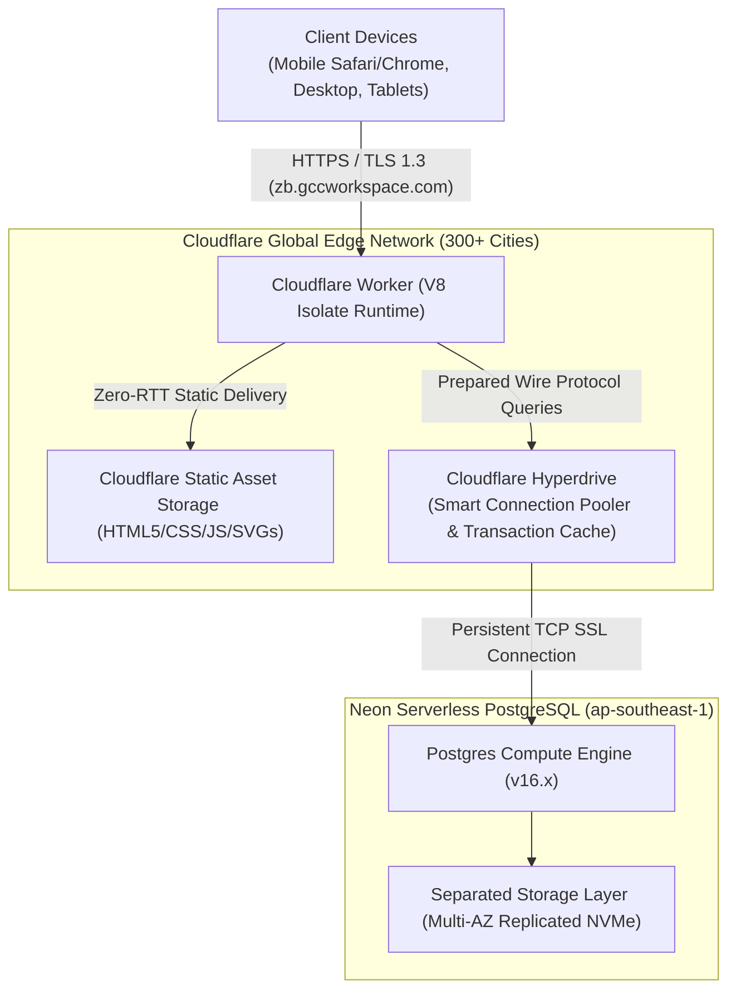
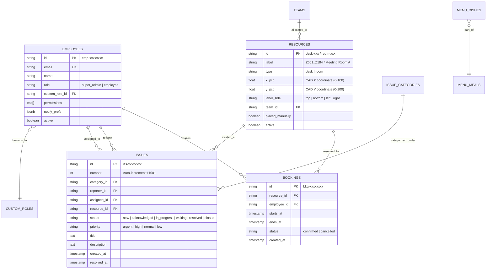

# System Architecture & Technical Design Document (HLD & LLD)
## Zimmer Biomet GCC Workspace Platform

---

## 1. High-Level Design (HLD)

### 1.1 Architectural Overview & System Context
The platform is built as a **Serverless, Edge-Native Single Page Application (SPA) with Edge API Execution**. It eliminates traditional long-running virtual machines, Kubernetes clusters, and container orchestration overhead.



### 1.2 Technology Stack Matrix
| Layer | Technology | Purpose & Architectural Rationale |
| :--- | :--- | :--- |
| **Edge Compute** | **Cloudflare Workers (V8 Isolates)** | Sub-50ms cold start (<5ms execution time); distributed globally across 300+ edge locations; zero server management or OS patching. |
| **Connection Pooling** | **Cloudflare Hyperdrive** | Eliminates TCP + TLS handshake latency to regional PostgreSQL instances; pools and reuses connections across edge isolates. |
| **Relational Database** | **Neon Serverless PostgreSQL (v16.x)** | Compute-storage decoupled relational database; supports branching, ACID transactions, and automatic compute pause when idle. |
| **Frontend Framework** | **React 19 + TypeScript (Strict Mode)** | Component-driven, type-safe UI layer with zero layout-shift hydration. |
| **Build & Bundler** | **Vite 7.x + Rollup** | High-efficiency modern ESM bundling, tree-shaking, and code-splitting under 180 KB gzipped core bundle. |
| **Vector Floor Map** | **SVG Vector Rendering Engine** | Mathematical coordinates normalized from CAD DWG/PDF drawings; infinite resolution scaling without raster pixelation. |
| **Security & Auth** | **Scrypt KDF + Session Tokens + Double-Submit CSRF** | Industry-standard password hashing (`N=8192, r=8, p=1`), HTTP-only SameSite cookies, double-submit CSRF tokens, strict CSP. |

---

## 2. Low-Level Design (LLD)

### 2.1 Database Entity Relationship (ER) Schema
The relational data model is normalized into clean domain boundaries with relational foreign keys and cascading rules.



### 2.2 Concurrency & Double-Booking Prevention Logic
One of the most critical engineering challenges in seat and room reservation systems is race condition management. If two users tap "Book" on desk `Z042` at the exact same millisecond, the system must guarantee that only one booking succeeds.

```
                    User A & User B tap "Book Z042" simultaneously
                                      │
                                      ▼
             Cloudflare Worker receives concurrent POST /api/bookings
                                      │
                                      ▼
                      Neon PostgreSQL Transaction Isolation
            BEGIN TRANSACTION ISOLATION LEVEL READ COMMITTED;
                                      │
            ┌─────────────────────────┴─────────────────────────┐
            ▼                                                   ▼
   [Transaction User A]                                [Transaction User B]
   Locks conflicting interval:                         Attempts to evaluate interval:
   SELECT 1 FROM bookings                              SELECT 1 FROM bookings
   WHERE resource_id = $1                              WHERE resource_id = $1
     AND status = 'confirmed'                            AND status = 'confirmed'
     AND tstzrange(starts_at, ends_at)                   AND tstzrange(starts_at, ends_at)
         && tstzrange($2, $3) FOR UPDATE;                    && tstzrange($2, $3) FOR UPDATE;
            │                                                   │
   No conflicting row found.                           Blocks until Transaction A commits.
   INSERT INTO bookings (...);                                  │
   COMMIT;                                             Conflict detected!
            │                                          ROLLBACK;
            ▼                                                   │
   HTTP 201 Created                                             ▼
   Booking Successful!                                 HTTP 409 Conflict
                                                       "Space was just booked by someone else."
```

### 2.3 Mathematical CAD Coordinate Normalization
Physical floor plans are rendered from AutoCAD vector files using normalized floating-point percentages:
$$\text{Point}(x_{\text{pct}}, y_{\text{pct}}) \in [0, 100] \times [0, 100]$$

1. **Aspect Ratio Preservation:**
   $$\text{Aspect Ratio} = \frac{\text{CAD Plan Width}}{\text{CAD Plan Height}} = \frac{1920}{1080} \approx 1.7778$$
2. **Dynamic Label Placement Algorithm (`labelLayout.ts`):**
   To prevent labels from overlapping adjacent desks or meeting room borders, each seat tests four candidate bounding boxes: $\text{Side} \in \{\text{top}, \text{bottom}, \text{left}, \text{right}\}$.
   The candidate box that produces zero geometric intersection with neighboring resource bounding boxes at the lowest viewport width is selected and stored.

### 2.4 Cloudflare Hyperdrive Read-Cache Semantics
When Cloudflare Worker runs in multi-instance V8 isolates:
- Read-only queries to Postgres are routed through Hyperdrive.
- To prevent the Worker from returning stale read data immediately after a user mutates state (such as updating notification preferences or editing a contact), queries that require real-time read-after-write consistency explicitly incorporate volatile functions:
  ```sql
  SELECT e.notify_prefs, now() AS read_at FROM employees e WHERE e.id = $1;
  ```
  This forces the query optimizer and edge cache to bypass intermediate connection buffers and pull directly from the database storage engine.
