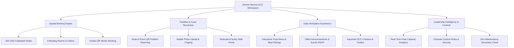

# Zimmer Biomet GCC Workspace
## Executive Presentation & Director Demo Deck

---

### Slide 1: Title & Executive Hook
**Title:** Zimmer Biomet GCC Workspace: Smart Workplace Experience & Real-Time Campus Intelligence  
**Subtitle:** A Serverless, Edge-Powered Digital Headquarters for Zimmer Biomet Global Capability Center  
**Presenter:** Engineering & Workplace Innovation Team  

> **Speaker Script:**  
> *"Good morning, Director. Today, I am excited to present the Zimmer Biomet GCC Workspace platform—a purpose-built, high-performance digital workplace solution designed specifically for our facility. In hybrid work, the physical office is no longer just a place people are forced to be; it is a collaboration hub where every minute must count. This platform solves desk contention, simplifies facility reporting, connects our cafeteria, and gives leadership real-time spatial analytics—all delivered at sub-second speeds with zero infrastructure bloat."*

---

### Slide 2: The Core Challenge: The Friction in Hybrid Offices
| Pain Point | Impact on Employee | Impact on Leadership |
| :--- | :--- | :--- |
| **Ghost Bookings & Seat Scramble** | Arriving at the office without knowing where teammates sit or if quiet desks are open | Wasted real estate expenditure, inaccurate floor capacity estimates |
| **Fragmented Facilities Reporting** | Broken coffee machine, air conditioning, or display requires sending emails or chasing staff | No audit trail, missed SLAs, frustrated employees |
| **Disconnected Daily Touchpoints** | Food menus on paper, disconnected emails for events, lost notices | Low workplace engagement, disconnected office culture |
| **Traditional SaaS Bloat** | Bulky commercial products cost \$5–\$12/seat/month and require heavy VPNs | High recurring annual licensing costs, sluggish mobile experiences |

> **Speaker Script:**  
> *"When employees come into our GCC, they face small daily frictions: 'Where is my team sitting today?', 'Is Meeting Room B available right now?', 'Who do I call if the AV system isn't displaying?', 'What is on the cafeteria menu?'. Traditional off-the-shelf software is expensive, clunky, and slow. We built a streamlined, lightning-fast platform customized exactly to our CAD floor plan, our workflows, and our people."*

---

### Slide 3: The Solution: Zimmer Biomet GCC Workspace
**A unified digital campus accessible on phone, tablet, and desktop with zero app store installation hurdles.**

---

### Slide 4: Persona Story 1 — "A Day in the Life of Priya (Software Engineer)"
* **8:30 AM (On the Shuttle):** Priya opens `zb.gccworkspace.com` on her smartphone. She checks *"Who's in today"* to see where her team is sitting.
* **8:31 AM (Interactive CAD Map):** She taps the floor plan. With our visual availability engine, she immediately sees which desks are free, booked, or taken. She taps desk **Z042** (next to her teammates) and reserves it in one click.
* **10:15 AM (Meeting Room Need):** An ad-hoc standup is called. She opens Meeting Rooms, spots **Collab Zone** is free for the next 45 minutes, and reserves it instantly.
* **1:00 PM (Cafeteria Lunch):** She browses the daily menu, filters by "Veg", checks dish ratings from yesterday, and likes the chef's special.
* **3:30 PM (Problem Report):** She notices a flickering light near her desk. She points her phone camera at the desk QR code sticker, snaps a photo, and submits the report in 10 seconds without logging into a ticketing system.

---

### Slide 5: Persona Story 2 — "A Day in the Life of Ramesh (Facilities Staff)"
* **Simplified Interface ("Staff Home"):** Ramesh doesn't need to navigate complex dashboards. He logs in with his Employee ID to a **clean, big-button mobile view**.
* **Instant Task Queue:** Priya's lighting issue appears right at the top of his queue tagged *"Electrical / Lighting · Desk Z042"*.
* **One-Tap Action:** Ramesh taps **"Start"** when he arrives at the location (which notifies Priya that facilities is on it), fixes the bulb, taps **"Done"**, and marks it resolved.
* **SLA Tracking:** If an urgent issue isn't picked up within 2 hours, the system automatically escalates it to the Facility Manager.

---

### Slide 6: Persona Story 3 — "The Director & Admin View (Strategic Governance)"
* **Real-Time Spatial Analytics:**
  - Track peak occupancy by day of week (e.g., Tuesdays and Thursdays at 84% capacity, Fridays at 42%).
  - Monitor meeting room utilization versus desk utilization to make data-driven real estate expansion decisions.
* **Granular Role-Based Access Control (RBAC):**
  - Super Admin, Facility Manager, Cafeteria Manager, HR, and Employee roles with grouped permissions.
  - Zero risk of privilege escalation.
* **Instant Feature Switches & Corporate Branding:**
  - Toggle features on or off in real time (Menu, Issue Box, Kudos, Events).
  - Customize official Zimmer Biomet signature blue `#0067b1`, logos, and login screens.

---

### Slide 7: Technical Architecture & Cost Efficiency
| Dimension | Traditional Enterprise Solution | Zimmer Biomet GCC Platform |
| :--- | :--- | :--- |
| **Hosting Model** | Heavy VMs (EC2 / Kubernetes) running 24/7 | 100% Serverless Edge (Cloudflare Workers + Neon DB) |
| **Latency** | 200ms – 600ms (centralized datacenter) | **< 50ms Global Response Time** (300+ edge locations) |
| **Idle Infrastructure Cost** | \$250 – \$600+ / month in cloud compute | **\$0 – \$5 / month** (scales to zero when office is closed) |
| **Floor Plan Fidelity** | Generic rectangular grid | **100% Precise Vector CAD Tender Drawing Coordinates** |
| **Security Posture** | Fragmented plugins | Strict CSP, Scrypt password hashing, CSRF tokens, Hyperdrive cache isolation |

---

### Slide 8: Next Steps & Immediate Rollout Plan
1. **Pilot Phase (Weeks 1–2):** Enable for IT & Facilities teams (Desks Z001–Z030, Meeting Rooms A–C).
2. **Floor Sticker Deployment (Week 2):** Print QR code stickers for all 184 desks and 8 conference rooms (using the built-in QR generator under Manage).
3. **Full GCC Launch (Week 3):** Onboard all employees with self-service password reset and mobile PWA installation ("Add to Home Screen").
4. **Corporate SSO Alignment (Post-Launch):** Federation with Microsoft Entra ID / Okta SAML.
